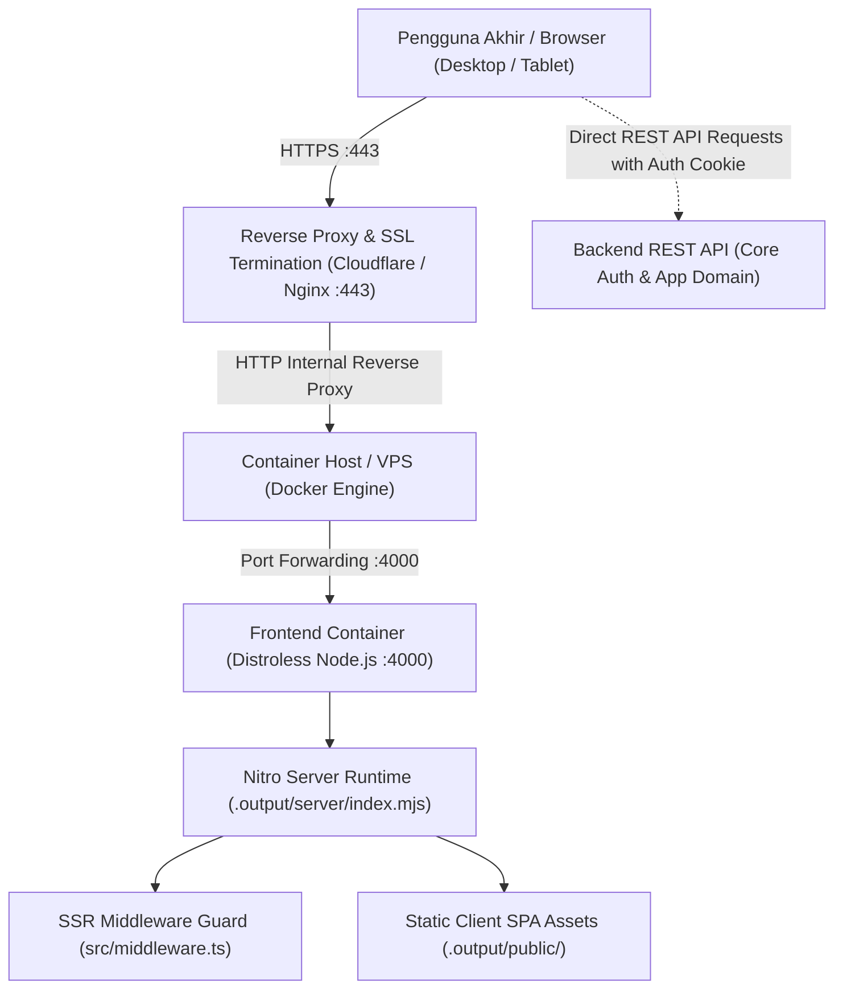

# SolidStart Frontend Boilerplate — Deployment & CI/CD Guide

> **Versi Dokumen**: 1.0.0 (Boilerplate Baseline)
> **Tanggal Efektif**: 4 November 2026
> **Status**: Active Baseline — Living Document (Adaptif & Updatable via Protokol §6)
> **Dokumen Terkait**: [`PRD.md`](./PRD.md) · [`ARCHITECTURE.md`](./ARCHITECTURE.md) · [`DESIGN.md`](./DESIGN.md) · [`API.md`](./API.md) · [`AGENTS.md`](./AGENTS.md)
> **Pemilik / Maintainer**: Developer (Personal / Team Project)
> **Audience**: Developer & DevOps / AI Assistant
>
> Dokumen ini adalah panduan resmi dan referensi tunggal (_single source of truth_) deployment, arsitektur containerization Docker (multi-stage build), pipeline GitHub Actions terintegrasi, konfigurasi environment multi-tier, serta tata kelola deployment untuk aplikasi frontend berbasis SolidStart Boilerplate.

---

## Daftar Isi

1. [Environment & Topologi Infrastruktur](#1-environment--topologi-infrastruktur)
   - 1.1 [Matriks Multi-Tier Environment](#11-matriks-multi-tier-environment)
   - 1.2 [Arsitektur & Topologi Jaringan](#12-arsitektur--topologi-jaringan)
   - 1.3 [Alur Permintaan & SSR Runtime Server](#13-alur-permintaan--ssr-runtime-server)
2. [Containerization & Docker Build Strategy](#2-containerization--docker-build-strategy)
   - 2.1 [Multi-Stage Dockerfile](#21-multi-stage-dockerfile)
   - 2.2 [Strategi `.dockerignore`](#22-strategi-dockerignore)
   - 2.3 [Instruksi Eksekusi Docker Lokal](#23-instruksi-eksekusi-docker-lokal)
3. [Pipeline CI/CD (GitHub Actions)](#3-pipeline-cicd-github-actions)
   - 3.1 [Tahapan Pipeline](#31-tahapan-pipeline)
   - 3.2 [Spesifikasi Workflow `.github/workflows/ci.yml`](#32-spesifikasi-workflow-githubworkflowsciyml)
   - 3.3 [Layanan Infrastruktur CI/CD](#33-layanan-infrastruktur-cicd)
   - 3.4 [Secret Variables CI/CD](#34-secret-variables-cicd)
4. [Konfigurasi Environment & Feature Flags](#4-konfigurasi-environment--feature-flags)
   - 4.1 [Variabel Environment Inti](#41-variabel-environment-inti)
   - 4.2 [Modul Feature Flags](#42-modul-feature-flags)
   - 4.3 [Hierarki File Environment](#43-hierarki-file-environment)
5. [Operasional, Monitoring & Troubleshooting](#5-operasional-monitoring--troubleshooting)
   - 5.1 [Health Check & SSR Heartbeat](#51-health-check--ssr-heartbeat)
   - 5.2 [Alokasi Resource Container](#52-alokasi-resource-container)
   - 5.3 [Prosedur Rollback Cepat](#53-prosedur-rollback-cepat)
   - 5.4 [Troubleshooting Masalah Umum](#54-troubleshooting-masalah-umum)
6. [Tata Kelola Dokumen (Living Document Protocol)](#6-tata-kelola-dokumen-living-document-protocol)
   - 6.1 [Alur Perubahan Konfigurasi Deployment](#61-alur-perubahan-konfigurasi-deployment)
   - 6.2 [Prinsip Pengelolaan Infrastruktur & CI/CD](#62-prinsip-pengelolaan-infrastruktur--cicd)
7. [Document Revision History](#7-document-revision-history)

---

## 1. Environment & Topologi Infrastruktur

### 1.1 Matriks Multi-Tier Environment

Aplikasi berbasis boilerplate ini mengadopsi standar multi-tier deployment untuk memisahkan siklus pengujian developer, UAT stakeholder, dan layanan operasional langsung:

| Environment     | Git Branch | URL Domain & DNS                                    | Backend API Base URL                                 | Status Implementasi          | Metode Deployment                            |
| :-------------- | :--------- | :-------------------------------------------------- | :--------------------------------------------------- | :--------------------------- | :------------------------------------------- |
| **Development** | `dev`      | `https://dev.example.com`     | `https://dev.example.com/`     | ✅ **Aktif & Dikonfigurasi** | Otomatis via GitHub Actions (push `dev`)          |
| **Staging**     | `staging`  | `https://staging.example.com` | `https://staging.example.com/` | ⏳ **Target Baseline (TBD)** | Otomatis via GitHub Actions (push `staging`)  |
| **Production**  | `main`     | `https://example.com`              | `https://api.example.com/`                     | ⏳ **Target Baseline (TBD)** | Manual Approval Gatekeeper (merge to `main`) |

> [!NOTE]
>
> - Domain dan instance server untuk **Staging** dan **Production** berstatus _Target Baseline_ dan akan difinalisasi bersama perwakilan tim infrastruktur proyek saat inisiasi deployment.
> - Seluruh konfigurasi routing reverse proxy dan SSL termination dikelola terpusat oleh tim DevOps / pengelola infrastruktur.

### 1.2 Arsitektur & Topologi Jaringan



### 1.3 Alur Permintaan & SSR Runtime Server

1. **Nitro Standalone Server**: Meskipun rendering frontend beroperasi dalam mode SPA (`ssr: false` pada `vite.config.ts`), engine Nitro tetap membungkus aplikasi ke dalam server Node.js mandiri (`.output/server/index.mjs`).
2. **SSR Middleware Execution**: Setiap _incoming request_ awal dievaluasi oleh [`src/middleware.ts`](./src/middleware.ts):
   - Memvalidasi ada/tidaknya auth cookie (`token` dan `refresh_token`).
   - Melakukan _server-side redirection_ cepat (misal mengarahkan `/` ke `/auth/sign-in` atau `/app/dashboard`) tanpa perlu menunggu browser men-download seluruh bundle JavaScript.
3. **Port Runtime**: Server Nitro secara default me-listen port `4000` (didefinisikan via env `PORT=4000` di container Docker).

---

## 2. Containerization & Docker Build Strategy

Untuk menjamin keamanan, reproducibilitas, dan ukuran image yang efisien di lingkungan server produksi, boilerplate ini menerapkan strategi **Multi-Stage Docker Build**.

### 2.1 Multi-Stage Dockerfile

```dockerfile
# ========================================================
# Stage 1: Build & Compilation (Builder)
# ========================================================
FROM node:24-alpine AS builder

WORKDIR /app

# 1. Install toolchain sistem yang dibutuhkan untuk native dependency compilation
RUN apk add --no-cache python3 make g++

# 2. Copy manifest dependencies
COPY package.json pnpm-lock.yaml ./

# 3. Aktifkan pnpm via Corepack dan install dependensi secara deterministik
RUN corepack enable && corepack prepare pnpm@latest --activate
RUN pnpm install --frozen-lockfile

# 4. Inject only public client configuration at build time.
# Never copy .env files into the Docker build context or image.
ARG VITE_APP_ENVIRONMENT=dev
ARG VITE_API_URL
ARG VITE_PROJECT_NAME=boilerplate
ARG VITE_APP_NAME="SolidStart App"
ARG VITE_ENABLE_MODULE_DASHBOARD=true
ARG VITE_ENABLE_MODULE_USER_MANAGEMENT=true
ARG VITE_ENABLE_MODULE_SAMPLE=true
ENV VITE_APP_ENVIRONMENT=${VITE_APP_ENVIRONMENT}
ENV VITE_API_URL=${VITE_API_URL}
ENV VITE_PROJECT_NAME=${VITE_PROJECT_NAME}
ENV VITE_APP_NAME=${VITE_APP_NAME}
ENV VITE_ENABLE_MODULE_DASHBOARD=${VITE_ENABLE_MODULE_DASHBOARD}
ENV VITE_ENABLE_MODULE_USER_MANAGEMENT=${VITE_ENABLE_MODULE_USER_MANAGEMENT}
ENV VITE_ENABLE_MODULE_SAMPLE=${VITE_ENABLE_MODULE_SAMPLE}

# 5. Copy seluruh source code repositori
COPY . .

# 6. Kompilasi bundle Vite, Nitro server, dan Tailwind CSS v4
RUN pnpm build

# ========================================================
# Stage 2: Production Distroless Runtime (Runner)
# ========================================================
FROM gcr.io/distroless/nodejs24-debian12

WORKDIR /app

# Salin output hasil kompilasi Nitro dan package manifest
COPY --from=builder /app/.output ./.output
COPY --from=builder /app/package.json ./

# Konfigurasi port dan environment runtime
ENV PORT=4000
ENV NODE_ENV=production

EXPOSE 4000

# Eksekusi server mandiri Nitro
CMD ["/app/.output/server/index.mjs"]
```

> [!IMPORTANT]
> **Keunggulan Distroless Container**:
>
> - **Zero Attack Surface**: Image distroless tidak menyertakan shell (`/bin/sh`, `/bin/bash`), package manager (`apk`, `apt`), atau utilitas eksternal yang dapat disalahgunakan penyerang.
> - **Kepatuhan Engine Node.js**: Stage builder dan runtime distroless menggunakan Node.js v24 yang selaras dengan deklarasi `"engines": { "node": ">=24" }` di [`package.json`](./package.json).
> - **Ukuran Minimalis**: Output image akhir berukuran ramping (< 150 MB), mempercepat transfer push/pull image di registry container.

### 2.2 Strategi `.dockerignore`

File `.dockerignore` wajib ada di root project untuk mencegah transfer file temporer, sensitif, atau file dependensi lokal ke dalam Docker daemon context:

```text
node_modules
.output
.git
.gitignore
.husky
.gemini
.agents
.docs-backup
agent
skills
.claude
.cursor
.grok
.hermes
.qwen
.windsurf
.vscode
.env
.env.*
!.env.example
*.md
coverage
test-results
playwright-report
blob-report
playwright/.cache
*.log
*.pem
*.key
*.p12
*.pfx
tmp
dist
```

### 2.3 Instruksi Eksekusi Docker Lokal

Developer atau tim QA dapat melakukan verifikasi container secara lokal sebelum perubahan di-push ke repository:

```bash
# 1. Build image Docker secara lokal dengan konfigurasi client non-rahasia
docker build \
  --build-arg VITE_APP_ENVIRONMENT=dev \
  --build-arg VITE_API_URL=http://localhost:8000 \
  --build-arg VITE_PROJECT_NAME=boilerplate \
  --build-arg VITE_APP_NAME="SolidStart App" \
  -t solidstart-boilerplate:local .

# 2. Jalankan container dengan mapping port 4000
docker run -d --name app-web-local -p 4000:4000 solidstart-boilerplate:local

# 3. Pantau log output server Nitro
docker logs -f app-web-local

# 4. Akses melalui browser
open http://localhost:4000

# 5. Hentikan container setelah pengujian
docker stop app-web-local && docker rm app-web-local
```

---

## 3. Pipeline CI/CD (GitHub Actions)

Pipeline otomatis berjalan pada GitHub Actions untuk menjaga mutu kode, standardisasi commit git, verifikasi build TypeScript/Nitro, hingga pembuatan container Docker.

### 3.1 Tahapan Workflow

Workflow GitHub Actions dibagi menjadi beberapa pekerjaan (_jobs_):

1. **`lint`**:
   - `biome-check`: Memverifikasi formatting kode, aturan linting Biome, dan import sorting (`pnpm exec biome check .`).
2. **`typecheck-and-build`**:
   - `typecheck`: Memastikan strict TypeScript type checking bebas error (`pnpm exec tsc --noEmit`).
   - `build`: Memverifikasi build SolidStart & Nitro server bundle (`pnpm build`).
3. **`docker` (Opsional / On Push to main/dev)**:
   - Membangun image Docker multi-stage dan mem-push ke GitHub Packages (GHCR) atau Docker Hub.

### 3.2 Spesifikasi Workflow `.github/workflows/ci.yml`

```yaml
name: CI Pipeline

on:
  push:
    branches: [main, dev, staging]
  pull_request:
    branches: [main, dev, staging]

jobs:
  lint:
    name: Biome Lint & Format Check
    runs-on: ubuntu-latest
    steps:
      - name: Checkout code
        uses: actions/checkout@v4

      - name: Install pnpm
        uses: pnpm/action-setup@v4

      - name: Setup Node.js
        uses: actions/setup-node@v4
        with:
          node-version: 24
          cache: pnpm

      - name: Install dependencies
        run: pnpm install --frozen-lockfile

      - name: Run Biome Check
        run: pnpm exec biome check .

  typecheck-and-build:
    name: TypeScript & Build Verification
    runs-on: ubuntu-latest
    steps:
      - name: Checkout code
        uses: actions/checkout@v4

      - name: Install pnpm
        uses: pnpm/action-setup@v4

      - name: Setup Node.js
        uses: actions/setup-node@v4
        with:
          node-version: 24
          cache: pnpm

      - name: Install dependencies
        run: pnpm install --frozen-lockfile

      - name: Typecheck
        run: pnpm exec tsc --noEmit

      - name: Build Application
        run: pnpm build

  test-unit:
    name: Unit Tests (Vitest)
    runs-on: ubuntu-latest
    steps:
      - name: Checkout code
        uses: actions/checkout@v4

      - name: Install pnpm
        uses: pnpm/action-setup@v4

      - name: Setup Node.js
        uses: actions/setup-node@v4
        with:
          node-version: 24
          cache: pnpm

      - name: Install dependencies
        run: pnpm install --frozen-lockfile

      - name: Run Unit Tests
        run: pnpm test

  test-e2e:
    name: End-to-End Tests (Playwright)
    runs-on: ubuntu-latest
    steps:
      - name: Checkout code
        uses: actions/checkout@v4

      - name: Install pnpm
        uses: pnpm/action-setup@v4

      - name: Setup Node.js
        uses: actions/setup-node@v4
        with:
          node-version: 24
          cache: pnpm

      - name: Install dependencies
        run: pnpm install --frozen-lockfile

      - name: Install Playwright Browsers
        run: pnpm exec playwright install --with-deps chromium

      - name: Run Playwright Tests
        run: pnpm test:e2e

      - name: Upload Playwright Report
        uses: actions/upload-artifact@v4
        if: ${{ !cancelled() }}
        with:
          name: playwright-report
          path: playwright-report/
          retention-days: 30
```

### 3.3 GitHub Actions Secrets & Variables

Variable rahasia dapat dikonfigurasi melalui **Repository Settings -> Secrets and variables -> Actions**:

| Secret / Variable Key | Tipe | Deskripsi & Kegunaan |
| :--- | :--- | :--- |
| `DOCKER_USERNAME` | Secret | Username untuk login ke container registry (DockerHub / GHCR) |
| `DOCKER_PASSWORD` | Secret | Access token / password registry |
| `VITE_API_URL` | Variable | Base URL backend API untuk environment build |

---

## 4. Konfigurasi Environment & Feature Flags

### 4.1 Variabel Environment Inti

Semua variabel environment frontend yang diakses pada sisi klien (_client-side_) wajib menggunakan prefix `VITE_` agar diinjeksi oleh bundler Vite saat waktu build:

| Variabel Environment   | Tipe Data | Deskripsi Fungsi                                                                                   | Contoh Nilai Development                           |
| :--------------------- | :-------- | :------------------------------------------------------------------------------------------------- | :------------------------------------------------- |
| `VITE_APP_ENVIRONMENT` | `string`  | Penanda tier environment (`dev`, `staging`, `prod`). Menjadi namespace prefix cookie auth.         | `'dev'`                                            |
| `VITE_API_URL`         | `string`  | Base URL endpoint REST API backend Rust (Axum/Actix). Wajib diakhiri tanda slash `/`.              | `'https://dev.example.com/'` |
| `VITE_PROJECT_NAME`    | `string`  | Identifier project sebagai bagian dari pembentukan nama cookie browser (`{env}_{project}_{name}`). | `'my-app'`                                       |
| `VITE_APP_NAME`        | `string`  | Nama aplikasi yang ditampilkan pada bar judul browser dan header navigasi.                         | `'My App'`                                       |

### 4.2 Modul Feature Flags

Setiap modul fungsional dapat diaktifkan atau dinonaktifkan secara independen tanpa memerlukan perubahan kode program. Konfigurasi dibaca secara terpusat oleh objek `MODULE_ACTIVE_CONFIG` pada [`src/config/app.ts`](./src/config/app.ts):

| Variabel Flag Modul                  | Modul Terkait             | Default Dev | Status Fase 1 (PRD) | Dampak Jika `false`                                                                                                                                  |
| :----------------------------------- | :------------------------ | :---------- | :------------------ | :--------------------------------------------------------------------------------------------------------------------------------------------------- |
| `VITE_ENABLE_MODULE_DASHBOARD`       | Dashboard Analitik        | `true`      | ✅ Active           | Navigasi menu dashboard aktif.                                                                                        |
| `VITE_ENABLE_MODULE_USER_MANAGEMENT` | User & Role Management    | `true`      | ✅ Active           | Melayani manajemen User, Role, Group, Menu, dan Permission sistem (`API_CORE`).                                       |
| `VITE_ENABLE_MODULE_SAMPLE`          | Contoh Modul Fitur Baru   | `true`      | ✅ Active           | Template contoh integrasi fitur domain aplikasi baru (`API_APP`).                                                     |

> [!NOTE]
> **Mekanisme Guard Modul**:
> Evaluasi aktifasi modul dilakukan berlapis:
>
> 1. **Sidebar Navigation**: Komponen menu memeriksa `MODULE_ACTIVE_CONFIG[KEY].IS_ACTIVE`. Jika bernilai `false`, menu tidak akan di-render di antarmuka pengguna.
> 2. **Route Guard Middleware**: Jika pengguna mengetikkan URL modul yang dinonaktifkan secara langsung pada browser, router SolidStart akan mengalihkan request ke halaman error 404.

### 4.3 Hierarki File Environment

| Nama File          | Status di Git               | Peruntukan & Deskripsi                                                                     |
| :----------------- | :-------------------------- | :----------------------------------------------------------------------------------------- |
| `.env`             | ❌ Diabaikan (`.gitignore`) | Konfigurasi aktif lokal mesin developer. Tidak boleh di-commit.                            |
| `.env.example`     | ✅ Di-commit                | Cetak biru (_blueprint_) seluruh key environment yang wajib diisi oleh developer baru.     |
| `.env.development` | ❌ Tidak di-commit          | Konfigurasi lokal opsional; konfigurasi build Development (`dev`) diinjeksi lewat build args atau CI. |
| `.env.staging`     | ❌ Tidak di-commit          | Konfigurasi lokal opsional; konfigurasi build Staging (`staging`) diinjeksi lewat build args atau CI. |
| `.env.production`  | ❌ Terproteksi              | Konfigurasi production murni yang diinjeksi via CI/CD secret atau orchestrator saat rilis. |

---

## 5. Operasional, Monitoring & Troubleshooting

### 5.1 Health Check & SSR Heartbeat

Untuk memastikan container berjalan normal dan siap melayani lalu lintas pengguna (_readiness probe_):

- **HTTP Heartbeat**: Reverse proxy (Nginx/Cloudflare) atau health checker melakukan polling HTTP `GET` ke root container port `4000`.
- **Status Kesiapan**: Respons HTTP `200 OK` (atau redirect `302` dari middleware auth) menandakan runtime Nitro dan SolidStart beroperasi optimal.

### 5.2 Alokasi Resource Container

Berdasarkan benchmark runtime Nitro Node.js distroless pada arsitektur SPA SolidJS, rekomendasi batas konsumsi resource container adalah sebagai berikut:

| Parameter Resource | Batas Minimum (Request) | Batas Maksimum (Limit) | Keterangan Operasional                                                                                 |
| :----------------- | :---------------------- | :--------------------- | :----------------------------------------------------------------------------------------------------- |
| **CPU**            | `0.25 vCPU` (250m)      | `1.0 vCPU` (1000m)     | Cukup untuk melayani SSR middleware routing dan static asset compression.                              |
| **Memory (RAM)**   | `256 MB`                | `1024 MB` (1 GB)       | Konsumsi rata-rata container berada di kisaran ~80-120 MB; batas 1 GB mencegah OOM saat traffic spike. |
| **Restart Policy** | `unless-stopped`        | `always`               | Container otomatis dihidupkan kembali jika terjadi crash mendadak.                                     |

### 5.3 Prosedur Rollback Cepat

Jika versi rilis terbaru mengalami _critical defect_ atau kegagalan fatal pada server:

1. **Rollback Container Tag**: Jalankan deployment ulang dengan menunjuk tag commit SHA stabil sebelumnya (misal `:a1b2c3d`) pada orchestrator container atau perintah `docker run`.
2. **Re-run Workflow**: Buka tab Actions di GitHub, temukan commit stabil terdahulu, lalu jalankan ulang workflow deployment.

### 5.4 Troubleshooting Masalah Umum

#### 1. Pipeline Gagal pada Stage `commitlint`

- **Gejala**: Workflow GitHub Actions merah pada job `commitlint` dengan pesan error _`subject may not be empty`_ atau _`type must be one of [feat, fix, ...]`_.
- **Penyebab**: Commit dibuat manual dengan pesan yang tidak mengikuti spesifikasi Conventional Commits.
- **Solusi**:
  Gunakan utilitas resmi repositori:
  ```bash
  git commit --amend # Perbaiki pesan commit terakhir
  # Atau buat commit selalu melalui Commitizen:
  pnpm git:commit
  ```

#### 2. Eror 401 Unauthorized / Infinite Redirect Loop

- **Gejala**: Pengguna berhasil login namun terus-menerus terlempar kembali ke layar `/auth/sign-in` atau `/auth/request-login`.
- **Penyebab**: Miskonfigurasi `VITE_API_URL` (lupa tanda trailing slash `/`), ketidaksesuaian `VITE_APP_ENVIRONMENT` dengan cookie server, atau perbedaan domain CORS.
- **Solusi**:
  Pastikan `VITE_API_URL` persis mengarah ke `https://dev.example.com/` dan cookie prefix cocok dengan tier yang sedang diuji.

#### 3. Out-Of-Memory (OOM) saat Docker Build

- **Gejala**: Runner GitHub Actions mati mendadak saat menjalankan perintah `pnpm build` dengan kode `Killed (SIGKILL)`.
- **Penyebab**: Alokasi RAM runner CI di bawah 1.5 GB saat menjalankan kompilasi Vite dan pemrosesan chunk vendor ECharts.
- **Solusi**:
  Tingkatkan memori runner GitHub Actions (self-hosted / larger runner) atau batasi worker Node dengan opsi environment `NODE_OPTIONS="--max-old-space-size=2048"`.

---

## 6. Tata Kelola Dokumen (Living Document Protocol)

Dokumen `DEPLOYMENT.md` berstatus **Approved Baseline — Living Document**. Dokumen ini bersifat adaptif dan dapat diperbarui mengikuti penambahan server staging/production, migrasi container registry, atau perubahan arsitektur pipeline CI/CD.

### 6.1 Alur Perubahan Konfigurasi Deployment

```
                   [ 1. Usulan Perubahan Deployment ]
    (Penambahan tier Staging/Prod, perubahan port, registry, atau variabel env)
                                   │
                                   ▼
                   [ 2. Analisis Dampak & Keamanan ]
   - Evaluasi keselarasan dengan PRD.md §3.5 dan ARCHITECTURE.md §2
   - Pastikan variabel rahasia tidak pernah di-commit ke Git repositori
   - Uji kompatibilitas Dockerfile multi-stage dan image Distroless
                                   │
                                   ▼
                 [ 3. Evaluasi & Persetujuan Developer ]
   Diverifikasi dan disetujui langsung oleh Developer / Pemilik Proyek
                                   │
                                   ▼
               [ 4. Sinkronisasi Dokumen & GitHub Actions ]
   - Perbarui DEPLOYMENT.md dan catat riwayat pada §7
   - Sinkronisasi file template .env.example dan .github/workflows/ci.yml
   - Update repository secrets pada GitHub Actions Secrets bila relevan
```

### 6.2 Prinsip Pengelolaan Infrastruktur & CI/CD

1. **Zero Plain Secrets in Repository**: Dilarang keras menaruh nilai password, token, atau private key pada repositori Git. Seluruh rahasia wajib dikelola via GitHub Actions Secrets atau Environment Variables.
2. **Distroless Container Runtime**: Lingkungan staging dan produksi wajib menggunakan base image distroless (`gcr.io/distroless/nodejs24`) untuk mencegah celah keamanan shell dan serangan remote code execution.
3. **Immutable Tagging**: Setiap image yang di-push ke container registry wajib memiliki tag spesifik commit SHA (`$CI_COMMIT_SHORT_SHA`) di samping tag `:latest` guna mempermudah auditabilitas dan proses rollback instan.
4. **Penyelarasan Multi-Dokumen**: Jika ada perubahan base URL, domain host, atau feature flags modul, lakukan sinkronisasi silang ke [`PRD.md`](./PRD.md), [`ARCHITECTURE.md`](./ARCHITECTURE.md), dan [`API.md`](./API.md).

---

## 7. Document Revision History

| Versi     | Tanggal     | Inisiator / Maintainer         | Ringkasan Perubahan & Catatan                                                                                                                                                                                                                                                                            |
| :-------- | :---------- | :----------------------------- | :------------------------------------------------------------------------------------------------------------------------------------------------------------------------------------------------------------------------------------------------------------------------------------------------------- |
| **1.0.0** | 4 Nov 2026  | Developer & AI Assistant       | **Baseline Resmi SolidStart Boilerplate Deployment Guide**:<br>• Rilis inisial panduan multi-tier environment, containerization Docker multi-stage distroless, dan standarisasi konfigurasi environment<br>• Integrasi pipeline CI/CD GitHub Actions (`.github/workflows/ci.yml`) untuk linting, typechecking, dan testing |

---

_Dokumen ini berstatus **Active Baseline**. Segala perubahan konfigurasi deployment lanjutan wajib mengikuti tata kelola pada §6 dan dicatat pada tabel riwayat revisi di atas._
_Versi: 1.0.0 (Boilerplate Baseline) — 4 November 2026_
